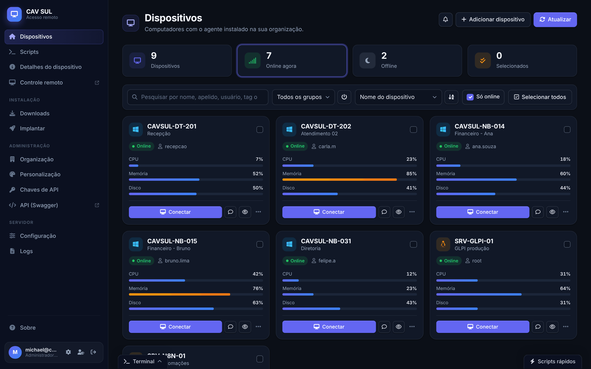
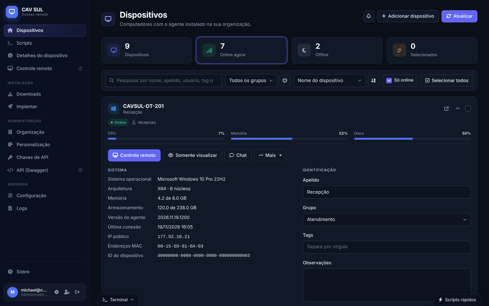
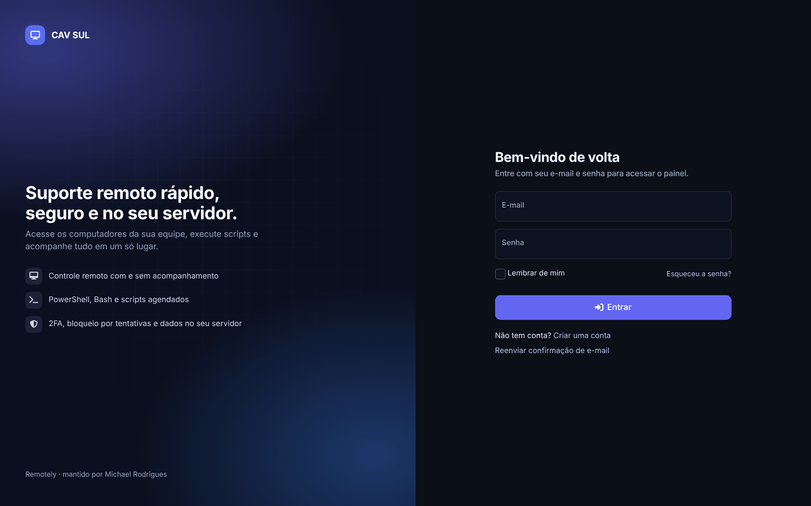
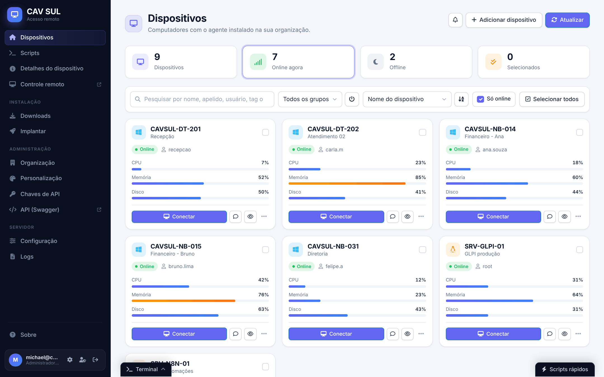
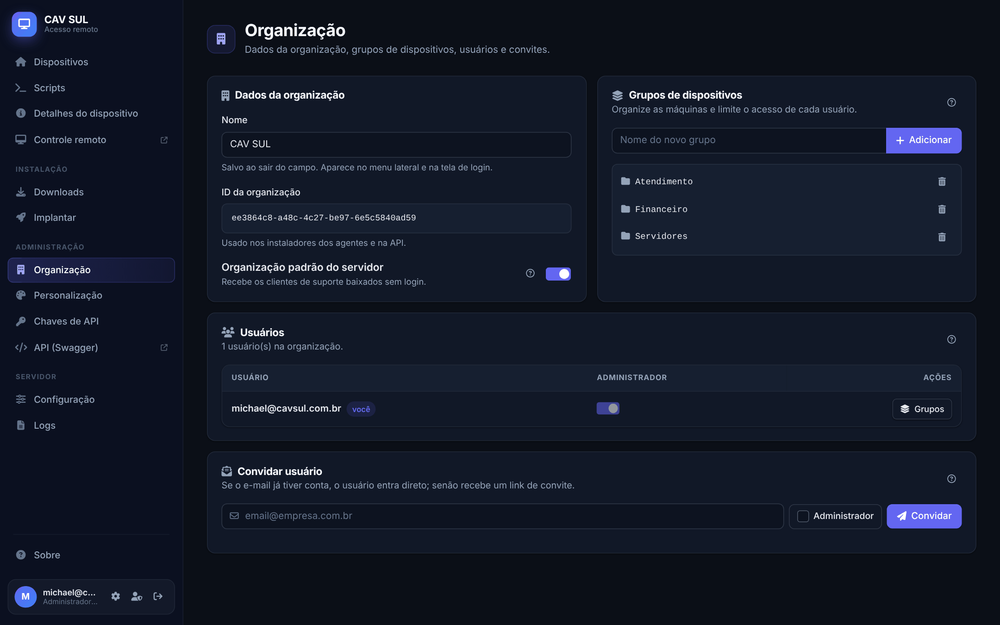
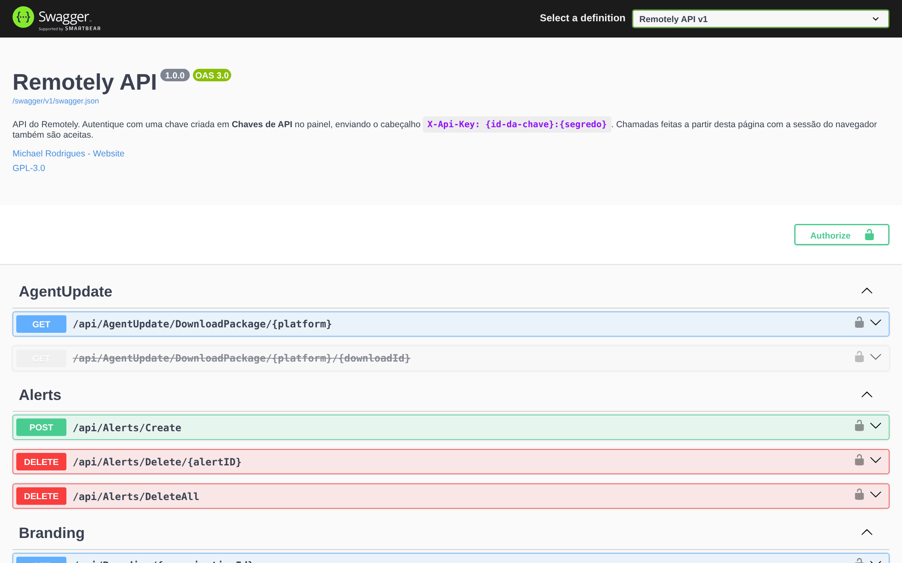

# Remotely — fork MichaelRodriguesOficial

[](https://github.com/MichaelRodriguesOficial/Remotely/actions/workflows/run_tests.yml)
[](https://github.com/MichaelRodriguesOficial/Remotely/actions/workflows/release.yml)
[](https://github.com/MichaelRodriguesOficial/Remotely/releases)
[](https://hub.docker.com/r/michechel10/remotely)

Solução de **suporte remoto**, **acesso autônomo** e **execução remota de scripts**, feita em .NET, Blazor e SignalR.

Este repositório é um fork do [immense/Remotely](https://github.com/immense/Remotely), cujo desenvolvimento foi encerrado (arquivado em dez/2024). Aqui o projeto segue mantido por **Michael Rodrigues**, com correções de segurança, interface nova em português e tudo em **.NET 10** (servidor, agents e clientes de desktop).



<table>
  <tr>
    <td></td>
    <td></td>
  </tr>
  <tr>
    <td align="center">Card aberto: inventário, ações e identificação</td>
    <td align="center">Configuração do servidor por seções</td>
  </tr>
  <tr>
    <td></td>
    <td></td>
  </tr>
  <tr>
    <td align="center">Login</td>
    <td align="center">Tema claro</td>
  </tr>
  <tr>
    <td></td>
    <td></td>
  </tr>
  <tr>
    <td align="center">Organização, grupos e usuários</td>
    <td align="center">API documentada no Swagger</td>
  </tr>
</table>

<p align="center"></p>

## O que muda neste fork

- **Tudo em .NET 10**: servidor, agents (Windows, Linux, macOS) e clientes de desktop, compilados no CI deste repositório (o .NET 8 saiu do suporte em novembro de 2026).
- **Interface nova em português (pt-BR)**: indicadores, busca e filtros numa barra só, cards com CPU/memória/disco e ações rápidas, login redesenhado, configurações por seções, temas escuro e claro e layout responsivo.
- **Swagger** em `/swagger`, disponível só para usuários logados, com autenticação por chave de API.
- **Segurança:** dezenas de correções. Entre elas:
  - páginas administrativas protegidas também na navegação interativa;
  - filtros de API que negam o acesso em caso de erro;
  - bloqueio de conta após 5 tentativas e rate limit no login;
  - validação do ID da organização nos instaladores (evita injeção de comandos);
  - correção de XSS com dados vindos dos dispositivos;
  - IDs de sessão com RNG criptográfico;
  - cabeçalhos de segurança;
  - documentação da API só para usuários logados;
  - dependências vulneráveis atualizadas.
- **Imagem Docker própria** (`michechel10/remotely`), sem root e com healthcheck.
- **Release enxuto**: o pacote do servidor tem só o necessário para Linux x64 e os agents vêm num pacote separado, baixado pelo atualizador apenas quando mudam.
- **Scripts de instalação e atualização** que usam os releases deste repositório e preservam banco, chaves e instaladores dos agents.

Lista completa em [CHANGELOG.md](CHANGELOG.md) e nos [releases](https://github.com/MichaelRodriguesOficial/Remotely/releases).

---

## Instalação com Docker (recomendada)

Requisitos: Docker e Docker Compose.

```bash
mkdir -p ~/remotely && cd ~/remotely
curl -fsSLO https://raw.githubusercontent.com/MichaelRodriguesOficial/Remotely/master/docker-compose/docker-compose.yml
curl -fsSL https://raw.githubusercontent.com/MichaelRodriguesOficial/Remotely/master/docker-compose/.env.example -o .env
docker compose up -d
```

Acesse `http://IP_DO_SERVIDOR:5000` e clique em **Cadastrar**. A primeira conta vira administradora do servidor e da organização. Depois disso, o cadastro público é desativado.

- **Dados:** os dados ficam no volume `remotely-data`, montado em `/app/AppData`. Lá estão o banco SQLite, os logs, as gravações e as chaves de criptografia.
- **Pasta do host em vez do volume:** monte `/sua/pasta:/app/AppData` e rode `sudo chown -R 1654:1654 /sua/pasta`, porque o container roda com o usuário `app`.
- **Versão:** defina `REMOTELY_TAG` no `.env` (ex.: `1.1.0` ou `latest`).
- **Atualizar:** `docker compose pull && docker compose up -d`.

A imagem também é publicada em `ghcr.io/michaelrodriguesoficial/remotely`.

## Instalação no Ubuntu (sem Docker)

Testado em Ubuntu 22.04 e 24.04. O script instala o ASP.NET Core Runtime 10 e o Nginx, com HTTPS opcional via Let's Encrypt. Depois baixa o servidor já compilado do último release e cria o serviço `remotely`.

```bash
curl -fsSLO https://raw.githubusercontent.com/MichaelRodriguesOficial/Remotely/master/remotely_install.sh
chmod +x remotely_install.sh
sudo ./remotely_install.sh
# versão específica:
sudo REMOTELY_VERSION=v1.1.0 ./remotely_install.sh
```

| Script | Para que serve |
|---|---|
| `remotely_install.sh` | Instalação completa (runtime, Nginx, SSL, serviço systemd). A opção 2 só verifica/renova o certificado. |
| `remotely_upgrade.sh` | Atualiza para o último release (ou `--version vX.Y.Z`). Faz backup, preserva banco, chaves e configurações, e religa a versão anterior se algo falhar. Também tem `--list-backups` e `--rollback NOME`. |
| `remotely_remove.sh` | Remove a instalação, com backup final do banco. |

Os arquivos ficam em `/var/www/remotely`, com os dados em `/var/www/remotely/AppData`. O Kestrel escuta só em `127.0.0.1:5000`; o acesso externo é feito pelo Nginx.

Cada release traz dois pacotes:

| Pacote | Conteúdo |
|---|---|
| `Remotely_Server_Linux-x64.zip` | Servidor (usa o ASP.NET Core Runtime 10 instalado). |
| `Remotely_Agents.zip` | Agents e clientes de suporte instantâneo, extraídos em `wwwroot/Content`. |

O `remotely_upgrade.sh` compara o SHA-256 do pacote de agents com o da instalação e só baixa de novo quando há agents novos.

## HTTPS e proxy reverso

Use um proxy reverso (Nginx, Caddy, Traefik) com HTTPS na frente do Remotely. Ele precisa repassar os cabeçalhos `X-Forwarded-Proto`, `X-Forwarded-Host` e `X-Forwarded-For`, além de suportar WebSockets.

O ASP.NET Core só aceita esses cabeçalhos de proxies conhecidos:

- **loopback**: liberado automaticamente;
- **gateway da rede Docker** (`172.28.0.1`): liberado automaticamente;
- **outros proxies**: cadastre o IP em **Configuração do servidor → Proxies conhecidos**.

Se o proxy não puder ser configurado direito, ative **Forçar HTTPS nos clientes**.

## Configuração

O banco e as strings de conexão ficam nas variáveis de ambiente (`.env` / `docker-compose.yml`) ou no `appsettings.json`. O resto é configurado na página **Configuração do servidor**, logado como administrador do servidor.

Opções exclusivas deste fork (`ApplicationOptions`, ou variáveis `Remotely_ApplicationOptions__*`):

| Opção | Padrão | Descrição |
|---|---|---|
| `EnableSwagger` | `true` | Publica a documentação da API em `/swagger`. Só abre para usuários logados no painel. |
| `AllowedFrameAncestors` | vazio | Origens que podem exibir o Remotely em `<iframe>` (ex.: `https://glpi.suaempresa.com.br`). Vazio = só o próprio Remotely. |
| `AuthRateLimitPerMinute` | `20` | Tentativas de login/cadastro/redefinição por IP por minuto. |

Banco de dados: `DbProvider` aceita `SQLite` (padrão), `SQLServer` ou `PostgreSQL`, com as strings de conexão `ConnectionStrings__SQLite`, `ConnectionStrings__SQLServer` e `ConnectionStrings__PostgreSQL`.

## Agents e clientes

Os instaladores dos agents (Windows, Linux, macOS) e os clientes de suporte instantâneo estão na página **Downloads**. A página **Implantar** traz um comando pronto para copiar e colar.

Os agents e clientes de desktop são compilados em **.NET 10** pelo workflow de release (no Windows) e entram na imagem Docker e no pacote `Remotely_Agents.zip`. Agents já instalados de versões anteriores se atualizam sozinhos quando o servidor passa a distribuir os novos. A tela de dispositivos marca como **desatualizado** quem estiver com versão anterior à distribuída (`wwwroot/Content/AgentVersion.txt`).

## API

Crie uma chave em **Chaves de API** e envie no cabeçalho `X-Api-Key: {id-da-chave}:{segredo}`.

```http
POST https://remotely.suaempresa.com.br/api/Scripting/ExecuteCommand/PSCore/{deviceId}
X-Api-Key: 31fb288d-af97-4ce1-ae7b-ceebb98281ac:HLkrKaZGExYvozSPvcACZw9awKkhHnNK
Content-Type: text/plain

Get-Location
```

A documentação interativa fica em `/swagger` (menu **Administração → API (Swagger)**). Ela abre para quem está logado; as chamadas feitas por lá usam a sua sessão, ou a chave informada em **Authorize**.

A API de alertas (`POST /api/Alerts/Create`) permite criar alertas no painel, enviar e-mails e chamar webhooks, como n8n ou Chatwoot.

## Desenvolvimento

- **SDK:** .NET 10 para toda a solução.
- **Windows:** necessário para compilar a solução inteira (`Desktop.Win`).
- **Agents:** `pwsh Utilities/Build-Agents.ps1` gera os agents, os clientes de desktop e o `AgentVersion.txt` em `Server/wwwroot/Content`.

```bash
dotnet build Remotely.sln
dotnet test
# só o servidor:
dotnet run --project Server
# imagem Docker local:
docker build -f Server/Dockerfile -t remotely:dev .
```

Os arquivos `.ts` do viewer (`Server/wwwroot/src`) são compilados para `.js` no build (requer Node.js) e os `.js` também ficam versionados.

### CI e releases

- **Tests:** compila a solução e roda os testes a cada push e PR.
- **Release:** em PRs e pushes, compila os agents no Windows, monta a imagem Docker com eles e faz um teste de fumaça. O teste sobe o container, migra o banco, cadastra o primeiro usuário e verifica login, permissões, Swagger, cabeçalhos e os arquivos dos agents.
- **Publicar uma nova versão:**
  1. Altere o arquivo `VERSION` (ex.: `1.1.1`).
  2. Adicione a seção `## v1.1.1` no `CHANGELOG.md`.
  3. Faça o push no `master`. O workflow cria a tag e o release com as notas, anexa `Remotely_Server_Linux-x64.zip` e `Remotely_Agents.zip` (com SHA-256) e publica a imagem no Docker Hub (`michechel10/remotely`) e no GHCR.
  - O Docker Hub exige os secrets `DOCKERHUB_USERNAME` e `DOCKERHUB_TOKEN` no repositório.

## Créditos e licença

Fork mantido por [Michael Rodrigues](https://github.com/MichaelRodriguesOficial).

Projeto original: [immense/Remotely](https://github.com/immense/Remotely), de Jared Goodwin (Immense Networks) e colaboradores.

Licença: [GPL-3.0](LICENSE), a mesma do projeto original. As bibliotecas de terceiros estão listadas na página **Créditos** do sistema.
