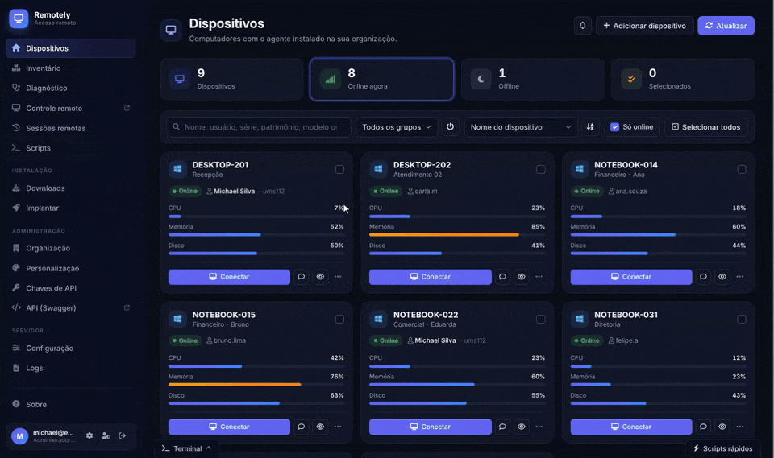
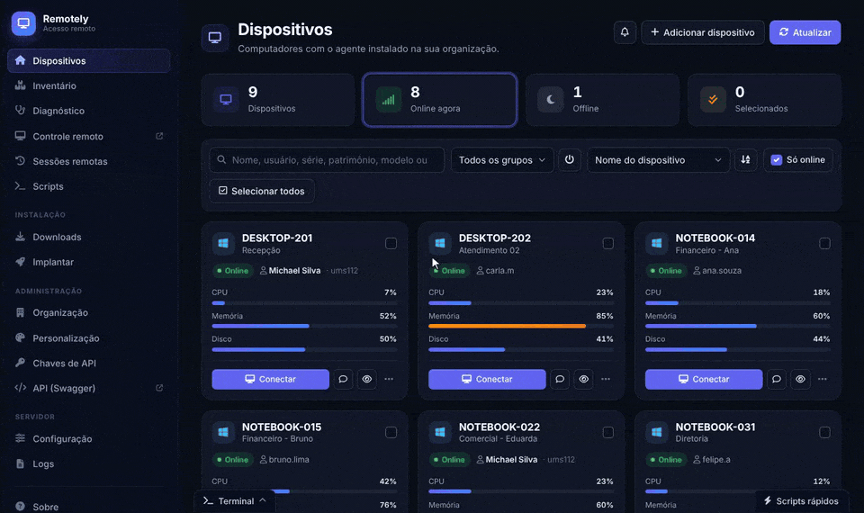
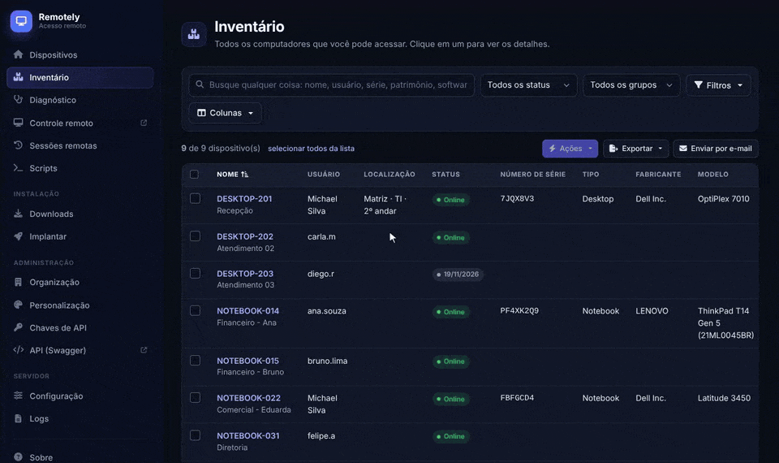
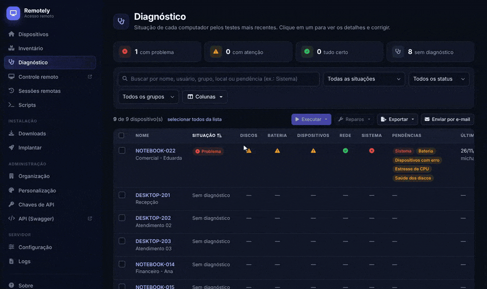
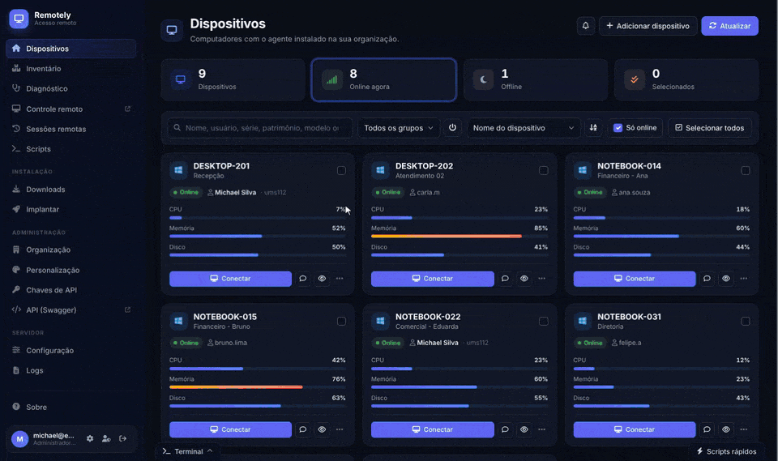
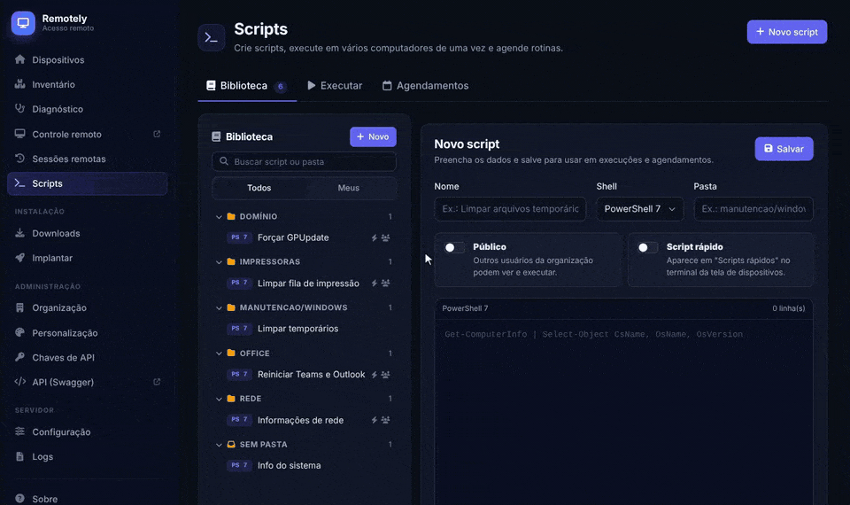
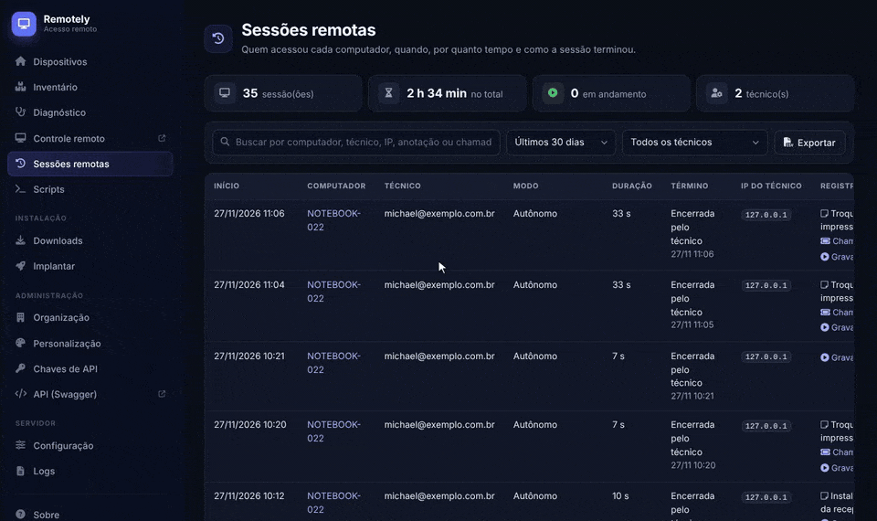
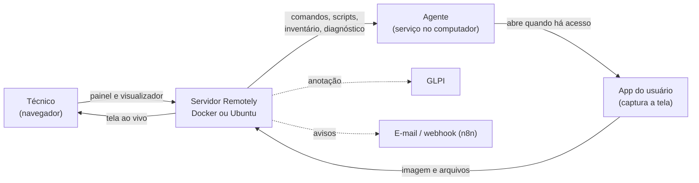

<p align="center">
  
</p>

<h1 align="center">Remotely</h1>

<p align="center">
  <b>Acesso remoto, inventário e diagnóstico dos computadores da empresa, num painel em português.</b><br>
  Controle a tela, rode scripts, descubra o que está errado e registre o atendimento no GLPI, tudo no seu próprio servidor.
</p>

<p align="center">
  <a href="https://github.com/MichaelRodriguesOficial/Remotely/releases/latest"></a>
  <a href="https://github.com/MichaelRodriguesOficial/Remotely/actions/workflows/run_tests.yml"></a>
  
  <a href="https://hub.docker.com/r/michechel10/remotely"></a>
  
  <a href="LICENSE"></a>
  <a href="https://github.com/sponsors/MichaelRodriguesOficial"></a>
</p>

<p align="center">
  <a href="#como-usar">Como usar</a> ·
  <a href="#instalacao">Instalação</a> ·
  <a href="#configuracao">Configuração</a> ·
  <a href="#seguranca">Segurança</a> ·
  <a href="#problemas">Solução de problemas</a> ·
  <a href="CHANGELOG.md">Changelog</a> ·
  <a href="#apoie">Apoie ☕</a>
</p>

<p align="center">
  
  <br><sub>Dispositivos, inventário, diagnóstico e histórico de sessões, e o controle remoto com atalhos, tela preta e painel do computador.</sub>
</p>

---

Fork mantido do [immense/Remotely](https://github.com/immense/Remotely), cujo desenvolvimento foi encerrado em dezembro de 2024.
Aqui o projeto continua com correções de segurança, interface nova em português, inventário, diagnóstico, integração com o GLPI e
tudo em **.NET 10** (servidor, agentes e app do usuário).

## ✨ Destaques

<table>
<tr>
<td width="50%" valign="top">

### 🖥️ Controle remoto de verdade
Copiar e colar texto e arquivos entre os dois computadores, menu de **atalhos** (Win+R, Ctrl+Alt+Del, Alt+Tab…),
enviar e baixar arquivos escolhendo a pasta, **tela preta** para o usuário, **reiniciar e voltar** (também em modo de
segurança) e painel lateral com os dados e o terminal do computador.

</td>
<td width="50%" valign="top">

### 📦 Inventário no estilo do GLPI
Fabricante, modelo, séries, BIOS, placa-mãe, processadores, memórias, discos, rede, monitores, softwares, antivírus e
BitLocker, com **busca em tudo** (`fabricante:dell software:zoom -status:offline`), colunas que você escolhe e ações
em lote.

</td>
</tr>
<tr>
<td width="50%" valign="top">

### 🩺 Diagnóstico e reparo
Saúde dos discos (SMART), bateria, dispositivos com erro, telas azuis, rede, atualizações e antivírus. Cada problema tem
um botão **Corrigir** (chkdsk, limpeza, sfc/DISM, rede, Windows Update…) que testa de novo no fim. Também agenda.

</td>
<td width="50%" valign="top">

### 🧾 Tudo registrado
**Histórico de sessões**: quem acessou, quando, por quanto tempo e como terminou. Ao encerrar, o técnico **anota o que
fez** e pode mandar como acompanhamento ou chamado novo no **GLPI**. Gravação das sessões por grupo.

</td>
</tr>
<tr>
<td width="50%" valign="top">

### ⚡ Scripts e terminal
Biblioteca de scripts em pastas, execução em vários computadores ao mesmo tempo, agendamentos, **scripts rápidos** com
um clique e terminal direto na tela de dispositivos. O histórico guarda a saída de cada execução.

</td>
<td width="50%" valign="top">

### 🔐 Seguro por padrão
**Chave por computador** (um computador não se passa por outro), aceite do usuário, perfis de acesso, 2FA, bloqueio
após tentativas, permissões conferidas no servidor e dezenas de correções em relação ao projeto original.

</td>
</tr>
<tr>
<td width="50%" valign="top">

### 👥 Perfis e grupos
Cada perfil define o que o técnico pode fazer (controlar ou só ver, arquivos, scripts, reparos) e quais grupos ele
enxerga. Por grupo: **aceite do usuário**, tela preta, gravação e aviso por e-mail ou webhook (n8n).

</td>
<td width="50%" valign="top">

### 🇧🇷 Em português e atualizado
Interface toda em português, temas claro e escuro, .NET 10, imagem Docker sem root e scripts de instalação e atualização
que preservam o banco e as chaves.

</td>
</tr>
</table>

### O que muda em relação ao Remotely original

| | Remotely original | Este fork |
|---|:---:|:---:|
| Mantido e em .NET atual | ❌ arquivado, .NET 8 | ✅ .NET 10 |
| Interface em português | — | ✅ |
| Copiar e colar arquivos, atalhos do Windows, tela preta | — | ✅ |
| Inventário de hardware e software com busca | — | ✅ |
| Diagnóstico com reparo em um clique | — | ✅ |
| Histórico de sessões, anotação e chamado no GLPI | — | ✅ |
| Aceite do usuário e regras por grupo | só "pedir permissão" | ✅ aceita sozinho em X s, exige ou não pergunta |
| Perfis de acesso por técnico | — | ✅ |
| Um computador não consegue se passar por outro | — | ✅ chave por computador |
| Scripts em pastas, agendamentos e scripts rápidos | básico | ✅ |

<a id="como-usar"></a>

## 🎬 Como usar, área por área

Gravado num servidor de demonstração com dados fictícios.

### 🏠 Dispositivos

Todos os computadores em cards, com CPU, memória e disco ao vivo. Busque por nome, usuário, série ou patrimônio, filtre
por grupo e abra o card para ver os detalhes. O menu **Mais** tem terminal, scripts rápidos, ligar (Wake-on-LAN),
reiniciar, desligar e enviar arquivo. Marque vários e use o **Terminal** de baixo para rodar um comando em todos.

<p align="center"></p>

### 📦 Inventário

A lista de todos os computadores, como a do GLPI. A busca procura em tudo, inclusive softwares e IPs:

- texto livre: `chrome`, `"Windows 11"`, `PAT-001237`, `10.10.20.57`;
- por campo: `tipo:notebook`, `fabricante:dell`, `software:zoom`, `local:matriz`, `status:offline`, `usuario:`, `patrimonio:`,
  `serie:`, `modelo:`, `so:`, `cpu:`, `grupo:`, `ip:`, `mac:`, `antivirus:`;
- excluir com `-` e combinar: `fabricante:dell software:chrome -status:offline`.

Escolha e reordene as colunas, selecione computadores para **Ações** em lote, e exporte em PDF, Excel, HTML ou JSON (ou
envie por e-mail). Dentro do computador: o inventário completo por seção e os **Eventos do Windows** com filtros.

<p align="center"></p>

### 🩺 Diagnóstico

Cards de saúde e uma linha por computador com o resultado de cada teste. **Executar** roda testes rápidos, o completo
(com estresse de CPU e teste de memória) ou os que você escolher, em um ou vários computadores. No computador, cada item
com problema tem o botão **Corrigir**, com confirmação e novo teste no fim.

<p align="center"></p>

### 🖥️ Controle remoto

**Conectar** no card abre a tela do computador. Conforme a regra do grupo, o usuário vê um pedido de permissão que aceita
sozinho em 30 segundos.

- **Atalhos:** Menu Iniciar, Executar (Win+R), Explorador, Gerenciador de Tarefas, Alt+Tab, Ctrl+Alt+Del, Bloquear…
  (fora da tela cheia o seu Windows pegaria esses atalhos antes).
- **Copiar e colar** automático, de texto e de arquivos, nos dois sentidos.
- **Arquivos:** enviar escolhendo a pasta do computador (ou arrastando para a tela) e baixar navegando pelo disco. O usuário
  vê o progresso e pode cancelar.
- **Tela preta** (Windows): o usuário vê "Manutenção em andamento" e fica com teclado e mouse bloqueados; você continua
  vendo a tela normalmente.
- **Painel** lateral com os dados do computador, terminal, scripts e envio de arquivos.
- **Reiniciar e voltar**, inclusive em **modo de segurança com rede**: a página espera o computador ligar e reconecta.
- **Encerrar** pede a anotação do que foi feito e, com o GLPI configurado, registra como acompanhamento ou chamado novo.

<p align="center"></p>

### ⚡ Scripts

Biblioteca em pastas (PowerShell, Windows PowerShell, CMD e Bash), públicos ou pessoais. **Executar** em grupos inteiros
ou computadores avulsos, inclusive nos offline quando conectarem. **Agendamentos** para rotinas. Marque um script como
**rápido** para ele aparecer no terminal da tela de dispositivos. A saída fica no **Histórico de scripts** de cada computador.

<p align="center"></p>

### 🧾 Sessões remotas, grupos e configuração

**Sessões remotas** mostra quem acessou cada computador, quando, por quanto tempo, como terminou, a anotação, o link do
chamado e a gravação. Em **Organização**, cada grupo tem as próprias regras: aceite do usuário, tela preta, gravação e
aviso de sessões. Em **Configuração** ficam o acesso remoto, o GLPI, a segurança, o e-mail e o diagnóstico agendado.

<p align="center"></p>

## 🧭 Como funciona



1. O **agente** roda como serviço em cada computador e mantém uma conexão de saída com o servidor (nenhuma porta é aberta
   no computador). Ele se identifica com a **chave** que só ele tem.
2. No painel, o técnico vê os dispositivos, o inventário e o diagnóstico, e manda scripts e reparos.
3. No acesso remoto, o agente abre o **app do usuário** na sessão de quem está logado, que pede o aceite (conforme o grupo)
   e transmite a tela pelo servidor até o navegador do técnico.
4. Tudo passa pelo servidor, que confere as permissões do técnico em cada ação e registra a sessão no histórico.

<a id="instalacao"></a>

## 📦 Instalação

### Docker (recomendado)

Requisitos: Docker e Docker Compose.

```bash
mkdir -p ~/remotely && cd ~/remotely
curl -fsSLO https://raw.githubusercontent.com/MichaelRodriguesOficial/Remotely/master/docker-compose/docker-compose.yml
curl -fsSL https://raw.githubusercontent.com/MichaelRodriguesOficial/Remotely/master/docker-compose/.env.example -o .env
docker compose up -d
```

Acesse `http://IP_DO_SERVIDOR:5000` e clique em **Cadastrar**. A primeira conta vira administradora do servidor e da
organização, e o cadastro público é desativado em seguida.

| | |
|---|---|
| **Dados** | Volume `remotely-data`, montado em `/app/AppData`: banco SQLite, logs, gravações e chaves de criptografia. |
| **Pasta do host** | Monte `/sua/pasta:/app/AppData` e rode `sudo chown -R 1654:1654 /sua/pasta` (o container roda como `app`). |
| **Versão** | `REMOTELY_TAG` no `.env` (ex.: `1.17.0` ou `latest`). |
| **Atualizar** | `docker compose pull && docker compose up -d` |

A imagem também está em `ghcr.io/michaelrodriguesoficial/remotely`.

### Ubuntu (sem Docker)

Testado no Ubuntu 22.04 e 24.04. O script instala o ASP.NET Core Runtime 10 e o Nginx (com HTTPS opcional pelo Let's
Encrypt), baixa o servidor do último release e cria o serviço `remotely`.

```bash
curl -fsSLO https://raw.githubusercontent.com/MichaelRodriguesOficial/Remotely/master/remotely_install.sh
chmod +x remotely_install.sh
sudo ./remotely_install.sh                              # ou: sudo REMOTELY_VERSION=v1.17.0 ./remotely_install.sh
```

| Script | Para que serve |
|---|---|
| `remotely_install.sh` | Instalação completa (runtime, Nginx, SSL, serviço). A opção 2 só verifica ou renova o certificado. |
| `remotely_upgrade.sh` | Atualiza para o último release (ou `--version vX.Y.Z`), com backup, e volta à versão anterior se algo falhar. Também `--list-backups` e `--rollback NOME`. |
| `remotely_remove.sh` | Remove a instalação, com um backup final do banco. |

Os arquivos ficam em `/var/www/remotely` (dados em `AppData`). O servidor escuta só em `127.0.0.1:5000`; o acesso externo
passa pelo Nginx. Cada release traz o servidor (`Remotely_Server_Linux-x64.zip`) e os agentes (`Remotely_Agents.zip`),
que o script só baixa de novo quando mudam.

### Agentes nos computadores

Os instaladores (Windows, Linux e macOS) e o cliente de suporte instantâneo estão em **Downloads**. A página **Implantar**
traz o comando pronto para copiar e colar. Os agentes se atualizam sozinhos
quando o servidor passa a distribuir uma versão nova.

<details>
<summary><b>HTTPS e proxy reverso (Nginx, aaPanel, Caddy, Cloudflare)</b></summary>
<br>

Use um proxy reverso com HTTPS na frente do Remotely. Ele precisa repassar o `Host` original, os cabeçalhos
`X-Forwarded-Proto` e `X-Forwarded-For` e suportar WebSockets. O `X-Forwarded-Host` é ignorado de propósito (evita que
alguém troque o endereço dos links de e-mail).

O servidor só aceita esses cabeçalhos de proxies conhecidos: loopback e o gateway da rede Docker (`172.28.0.1`) são
liberados sozinhos; outros, cadastre em **Configuração → Rede e registros → Proxies conhecidos**.

```nginx
location / {
    proxy_pass         http://127.0.0.1:5000;
    proxy_http_version 1.1;
    proxy_set_header   Upgrade $http_upgrade;
    proxy_set_header   Connection "upgrade";
    proxy_set_header   Host $host;
    proxy_set_header   X-Forwarded-For $proxy_add_x_forwarded_for;
    proxy_set_header   X-Forwarded-Proto $scheme;
    proxy_buffering    off;
    proxy_cache        off;
    proxy_read_timeout 1h;
}
```

**aaPanel:** o proxy já vem com WebSocket e `X-Forwarded-For`; falta o esquema. Em **Site → (seu site) → Proxy de URL →
Config**, no campo "Catálogo Proxy", coloque `proxy_set_header X-Forwarded-Proto $scheme;`. Não use as "Configurações
personalizadas" do bloco `server`: o Nginx não repassa `proxy_set_header` para uma `location` que já define os seus.

Se o proxy não puder ser configurado direito, ligue **Forçar HTTPS nos agentes**.

</details>

<a id="configuracao"></a>

## ⚙️ Configuração

Quase tudo é configurado no painel, em **Configuração** (administrador do servidor) e **Organização** (administrador da
organização).

| Onde | O que configurar |
|---|---|
| **Configuração → Acesso remoto** | Aceite do usuário (aceita sozinho em X s, sempre exige ou não pergunta), encerrar sessão parada, aviso ao usuário, aviso por e-mail ou webhook quando alguém acessa grupos sensíveis. |
| **Configuração → GLPI** | Endereço, App-Token e token do usuário da API REST do GLPI, para a anotação virar acompanhamento ou chamado. |
| **Configuração → Segurança** | 2FA obrigatório, login exigido no controle remoto, HTTPS, HSTS e **Exigir chave nos agentes**. |
| **Configuração → Diagnóstico agendado** | Testes que rodam sozinhos nos computadores, e quando. |
| **Configuração → E-mail (SMTP)** | Servidor de e-mail para avisos, relatórios e redefinição de senha. |
| **Organização → Grupos** | Por grupo: aceite do usuário, tela preta, gravação das sessões e aviso de sessões. |
| **Organização → Perfis de acesso** | O que cada técnico pode fazer e quais grupos ele enxerga. |

<details>
<summary><b>Variáveis de ambiente (banco, Swagger, iframe, proxies)</b></summary>
<br>

O banco e as strings de conexão ficam no `.env` / `docker-compose.yml` ou no `appsettings.json`. `DbProvider` aceita
`SQLite` (padrão), `SQLServer` ou `PostgreSQL`, com `ConnectionStrings__SQLite`, `ConnectionStrings__SQLServer` e
`ConnectionStrings__PostgreSQL`.

Opções deste fork (`Remotely_ApplicationOptions__*`):

| Opção | Padrão | Descrição |
|---|---|---|
| `EnableSwagger` | `true` | Documentação da API em `/swagger`, só para quem está logado. |
| `AllowedFrameAncestors` | vazio | Origens que podem exibir o Remotely em `<iframe>` (ex.: `https://glpi.suaempresa.com.br`). |
| `TrustPrivateNetworkProxies` | automático | De quem aceitar `X-Forwarded-*`. Automático: no Docker, só da rede do contêiner. `true`: de qualquer rede privada. `false`: só loopback e proxies conhecidos. |
| `AuthRateLimitPerMinute` | `20` | Tentativas de login, cadastro e redefinição por IP por minuto. |

</details>

<details>
<summary><b>API</b></summary>
<br>

Crie uma chave em **Chaves de API** e envie no cabeçalho `X-Api-Key: {id}:{segredo}`.

```http
POST https://remotely.suaempresa.com.br/api/Scripting/ExecuteCommand/PSCore/{deviceId}
X-Api-Key: 31fb288d-af97-4ce1-ae7b-ceebb98281ac:HLkrKaZGExYvozSPvcACZw9awKkhHnNK
Content-Type: text/plain

Get-Location
```

- `GET /api/Devices/{id}/inventory`: o inventário completo de um computador (JSON), para integrar com o GLPI ou planilhas.
- `POST /api/Alerts/Create`: cria alertas no painel, envia e-mails e chama webhooks (n8n, Chatwoot…).
- Documentação interativa em `/swagger` (menu **API (Swagger)**), para quem está logado.

</details>

<a id="seguranca"></a>

## 🔐 Segurança

| Preocupação | Como é tratada |
|---|---|
| **Um computador infectado se passar por outro** | Cada agente gera uma **chave secreta própria**; o servidor guarda só o hash. Com a chave registrada, só aquele computador conecta com aquele ID. Tentativas erradas são recusadas e geram alerta no painel. |
| **Agentes e o servidor** | O agente só abre conexões de saída e só executa o que vem do servidor. Ele não acessa o servidor de outra forma. Use HTTPS e, se possível, deixe o servidor numa rede separada. |
| **Quem pode fazer o quê** | Perfis de acesso por técnico (controlar ou só ver, arquivos, área de transferência, Ctrl+Alt+Del, scripts, reparos), conferidos no servidor em cada mensagem, não só escondendo botões. |
| **Usuário do computador** | Aceite configurável por grupo, aviso de sessão na tela, botão "Encerrar acesso" e janela de progresso ao enviar ou baixar arquivos. |
| **Login** | 2FA (opcional ou obrigatório), bloqueio após 5 tentativas, limite por IP, sessão com RNG criptográfico. |
| **Registro** | Histórico de sessões com IP do técnico, anotação e gravação (assistir ou baixar só para administradores). |
| **Painel** | Páginas administrativas protegidas também na navegação interativa, cabeçalhos de segurança, XSS corrigido nos dados vindos dos computadores, Swagger só para quem está logado. |
| **Instaladores** | ID da organização validado (sem injeção de comandos), chave do agente mantida nas atualizações. |

<a id="problemas"></a>

## 🛠️ Solução de problemas

<details>
<summary><b>O painel abre, mas os botões não respondem</b></summary>
<br>

O painel usa uma conexão em tempo real (WebSocket em `/_blazor`). Se ela não sobe, as páginas abrem mas nada funciona, e
aparece um aviso vermelho no rodapé. Confira os cabeçalhos `Upgrade`/`Connection` no proxy, o cache do proxy desligado para
o site e, no Cloudflare, WebSockets ligado e Rocket Loader desligado.
</details>

<details>
<summary><b>Um computador parou de conectar depois de formatado, restaurado ou clonado</b></summary>
<br>

A chave do agente mudou e o servidor ainda espera a antiga. O painel mostra o alerta "Conexão recusada". Nos detalhes do
computador, use **Redefinir chave do agente**: o próximo agente que conectar com aquele ID registra a chave nova.
</details>

<details>
<summary><b>Win+R abre o Executar no meu computador, não no remoto</b></summary>
<br>

Fora da tela cheia, o seu Windows pega os atalhos com a tecla Windows antes do navegador. Use o menu **Atalhos** da barra
ou entre em tela cheia, que manda Win, Alt+Tab e afins ao computador remoto.
</details>

<details>
<summary><b>A tela preta não liga</b></summary>
<br>

Ela precisa do Windows 10 versão 2004 ou mais novo (é o que permite esconder a cobertura da captura). Em versões antigas,
Linux e macOS, o visualizador avisa e esconde o botão. O grupo do computador também pode ter a tela preta desativada.
</details>

<details>
<summary><b>A anotação não chegou ao GLPI</b></summary>
<br>

A anotação fica salva no histórico mesmo assim, e o visualizador mostra o motivo. Confira em **Configuração → GLPI** o
endereço, o App-Token e o token do usuário, e se a API REST está ligada no GLPI (**Configurar → Geral → API**). Para
acompanhamento, o chamado precisa existir e o usuário da API precisa poder vê-lo.
</details>

<details>
<summary><b>A gravação da sessão não aparece</b></summary>
<br>

A gravação é feita pelo navegador do técnico e enviada ao servidor durante a sessão. Ligue **Gravar sessões** no grupo do
computador (ou **Gravar todas as sessões** em **Configuração → Acesso remoto**). As gravações ficam em `AppData/recordings` e só
administradores da organização veem o link.
</details>

<details>
<summary><b>O agente não aparece como online</b></summary>
<br>

Veja os logs do agente em **Detalhes → Logs do agente** (quando ele já conectou alguma vez). Confira se o computador alcança o endereço do servidor e se o ID da organização
está certo. Com **Exigir chave nos agentes** ligado, agentes antigos são recusados até atualizarem.
</details>

## 🧪 Desenvolvimento

<details>
<summary><b>Compilar, testar e publicar</b></summary>
<br>

- **SDK:** .NET 10. O Windows é necessário para compilar a solução inteira (`Desktop.Win`).
- **Agentes:** `pwsh Utilities/Build-Agents.ps1` gera os agentes, o app do usuário e o `AgentVersion.txt` em
  `Server/wwwroot/Content`.
- **Visualizador:** os `.ts` de `Server/wwwroot/src` são compilados para `.js` no build (requer Node.js); os `.js` também
  ficam versionados.

```bash
dotnet build Remotely.sln
dotnet test
dotnet run --project Server                       # só o servidor
docker build -f Server/Dockerfile -t remotely:dev .
```

**CI:** a cada push e PR, os testes rodam e os agentes são compilados no Windows; a imagem Docker passa por um teste de
fumaça (sobe o container, migra o banco, cadastra o primeiro usuário e confere login, permissões, Swagger e cabeçalhos).

**Nova versão:** altere `VERSION`, adicione a seção no `CHANGELOG.md` e faça o push no `master`. O workflow cria a tag e o
release com os pacotes (e SHA-256) e publica a imagem no Docker Hub e no GHCR.

</details>

<a id="apoie"></a>

## ☕ Apoie o projeto

<div align="center">

**Curtiu o Remotely?** É um projeto independente e de código aberto, mantido com cuidado para que equipes de TI tenham
acesso remoto, inventário e diagnóstico no próprio servidor, sem licença por técnico. Se ele facilita o dia a dia da sua
equipe, você pode me pagar um café 💚. É totalmente opcional: uma ⭐ no repositório, um relato de bug, uma ideia ou um PR
ajudam tanto quanto.

<table>
<tr>
<th width="50%">🌎 De qualquer lugar</th>
<th width="50%">🇧🇷 Do Brasil, via Pix</th>
</tr>
<tr>
<td align="center" valign="middle">

<a href="https://github.com/sponsors/MichaelRodriguesOficial"></a>

<sub>Uma vez ou todo mês, qualquer valor.<br>O GitHub não cobra taxa de patrocínios pessoais.</sub>

</td>
<td align="center" valign="middle">

<br>
<sub>Aponte a câmera do app do seu banco</sub>

<details>
<summary><sub>Pix copia e cola</sub></summary>

```
00020126820014br.gov.bcb.pix01363d43ffaa-4b56-45ed-b038-ba7407c0a9750220Cafe para o Remotely5204000053039865802BR5917MICHAEL G R SILVA6009SAO PAULO62070503***63040BF1
```

</details>

</td>
</tr>
</table>

</div>

## 📄 Créditos e licença

Fork mantido por **Michael Rodrigues** · [github.com/MichaelRodriguesOficial](https://github.com/MichaelRodriguesOficial)

Projeto original: [immense/Remotely](https://github.com/immense/Remotely), de Jared Goodwin (Immense Networks) e
colaboradores. Licença [GPL-3.0](LICENSE), a mesma do projeto original. As bibliotecas de terceiros estão na página
**Sobre** do sistema.
